# computer-science-lab4
# Лабораторная работа №4
**Тема:** Анализ набора данных с помощью SQL  
**Предметная область:** образовательная платформа  
**СУБД:** SQLite  
**Файл базы:** `dataset.sqlite`


## Шаг 1. Загрузка базы и первичная проверка

В SandboxSQL загружена SQLite-база. Выполнена проверка числа строк во всех шести таблицах.

**Количество записей.** 

```sql
SELECT 'groups' AS table_name, COUNT(*) AS rows_count FROM groups UNION ALL SELECT 'students', COUNT(*) FROM students UNION ALL SELECT 'teachers', COUNT(*) FROM teachers UNION ALL SELECT 'courses', COUNT(*) FROM courses UNION ALL SELECT 'enrollments', COUNT(*) FROM enrollments UNION ALL SELECT 'results', COUNT(*) FROM results;
```

**Результат:**

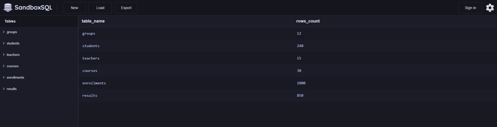

**Вывод:** все шесть таблиц доступны, всего 2147 записей.

## Шаг 2. Изучение структуры и формулирование аналитических вопросов

База содержит шесть связанных таблиц:

| Таблица | Назначение | Основные поля | Записей |
|---|---|---|---:|
| `groups` | Учебные группы | `id`, `group_name`, `study_year` | 12 |
| `students` | Студенты | `id`, `full_name`, `group_id`, `admission_year` | 240 |
| `teachers` | Преподаватели | `id`, `full_name`, `department` | 15 |
| `courses` | Курсы | `id`, `course_name`, `hours`, `teacher_id` | 30 |
| `enrollments` | Записи на курсы | `id`, `student_id`, `course_id`, `enrolled_at`, `status` | 1000 |
| `result` | Итоговые оценки | `id`, `enrollment_id`, `score`, `completed_at` | 850 |

**Связи:** `students.group_id → groups.id`; `courses.teacher_id → teachers.id`; `enrollments.student_id → students.id`; `enrollments.course_id → courses.id`; `result.enrollment_id → enrollments.id`. В каждой таблице `id` — первичный ключ.

**Просмотр данных.** Просмотр первых пяти регистраций.

```sql
SELECT * FROM enrollments LIMIT 5;
```

**Результат:**

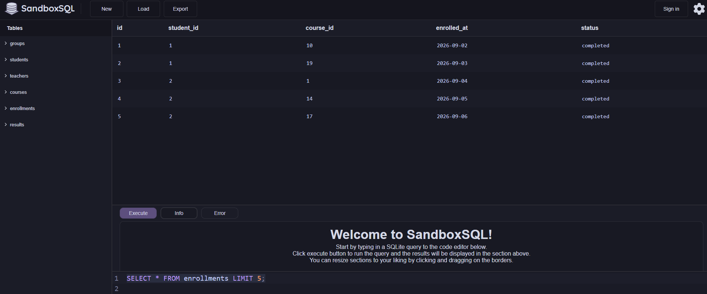

**Структура таблицы.** Просмотр полей и типов данных таблицы `enrollments`.

```sql
PRAGMA table_info(enrollments);
```

**Результат:**

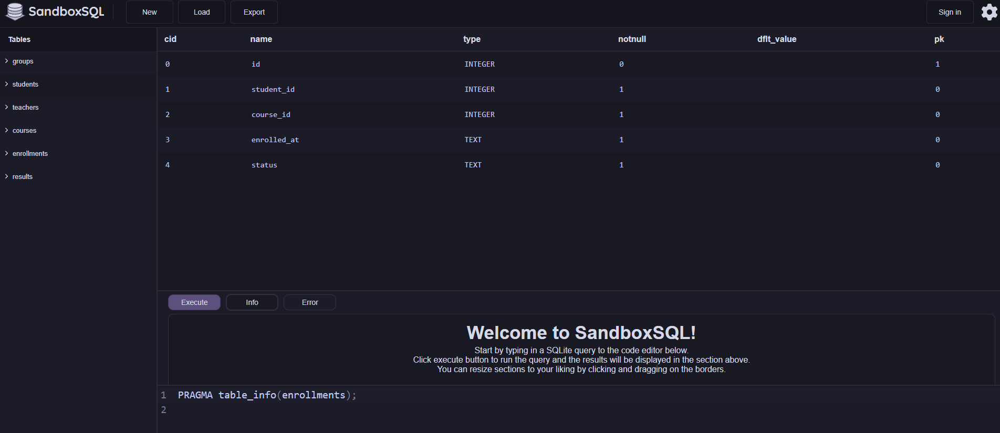

**Первичные и внешние ключи. Связи между таблицами**

В базе данных используются первичные ключи (`PRIMARY KEY`) для идентификации записей и внешние ключи (`FOREIGN KEY`) для связи таблиц.

- `groups.id` — первичный ключ группы.
- `students.id` — первичный ключ студента.
- `teachers.id` — первичный ключ учителя.
- `courses.id` — первичный ключ курса.
- `enrollments.id` — первичный ключ регистрации.
- `result.id` — первичный ключ результата.

**Связи между таблицами:**

- `enrollments.student_id → students.id` — каждая регистрация связана с конкретным студентом.
- `enrollments.course_id → courses.id` — каждая регистрация связана с конкретным курсом.
- `courses.teacher_id → teachers.id` — курс связан с учителем.
- `result.enrollment_id → enrollments.id` — результат связан с конкретной регистрацией.
- `students.group_id → groups.id` — каждый студент имеет конкретную группу.

Таким образом, таблица `enrollments` связывает студентов и курс, а таблица `result` позволяет получить информацию о результате конкретного зарегистрировавшегося студента. Через таблицу `courses` можно получить краткую информацию о курсе.

**Сформулированные аналитические вопросы:**

1. Какие курсы имеют больше всего итоговых оценок и какова их средняя оценка? Почему количество записей на курс может отличаться от количества оценок? → courses, enrollments, results → COUNT(r.id), AVG(r.score), COUNT(e.id).
2. Сколько курсов закреплено за каждым преподавателем? → teachers, courses → COUNT(courses.id).
3. Сколько записей на курсы в каждом статусе? → enrollments → COUNT(*) GROUP BY status.
4. Какие студенты не имеют ни одной записи на курс? → students, enrollments → LEFT JOIN … WHERE e.id IS NULL.
5. Как распределены оценки по диапазонам (<70, 70–89, ≥90)? → results → COUNT(*) по CASE.
6. Сколько оценок приходится на каждый курс? → courses, enrollments, results → COUNT(results.id).
7. Какие группы имеют наибольшее число студентов? → groups, students → COUNT(students.id).

## Шаг 3. Фильтрация и сортировка

**Фильтрация по продолжительности курса.** Отбираем курсы с продолжительностью не меньше 60 часов.

```sql
SELECT id, course_name, hours FROM courses WHERE hours >= 60 ORDER BY hours DESC, course_name LIMIT 1000;
```

**Результат:**

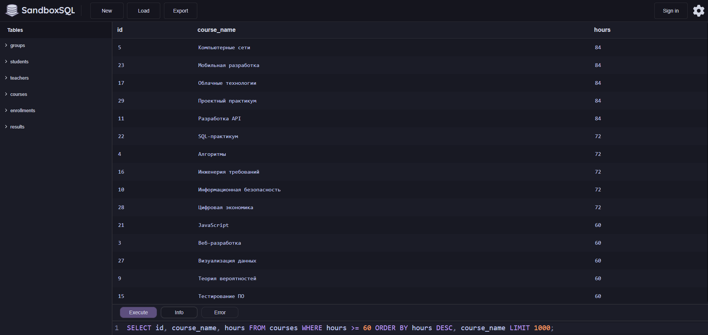

**Сортировка клиентов.** Выводим клиентов из Казани по алфавиту.

```sql
SELECT id, full_name, admission_year FROM students WHERE admission_year = '2025' ORDER BY full_name LIMIT 10;
```

**Результат:**

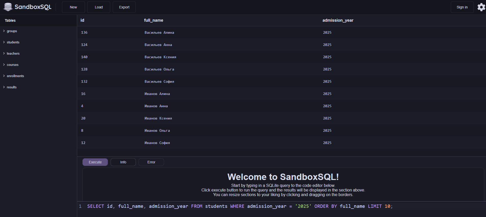

**Вывод:** `WHERE` отбирает нужные строки, `ORDER BY` сортирует, `LIMIT` ограничивает объём вывода.

## Шаг 4. Агрегирование и группировка

**Подсчёт курсов.** Определяем общее число курсов.

```sql
SELECT COUNT(*) AS id FROM courses;
```

**Результат:**

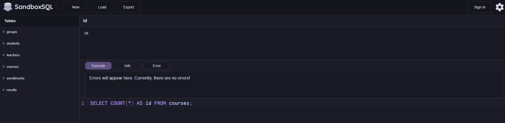

**Агрегатные функции.** Рассчитываем минимальную, максимальную, среднюю и суммарную продолжительность курсов.

```sql
SELECT MIN(hours) AS min_hours, MAX(hours) AS max_hours, ROUND(AVG(hours),2) AS avg_hours, SUM(hours) AS sum_hours FROM courses;
```

**Результат:**

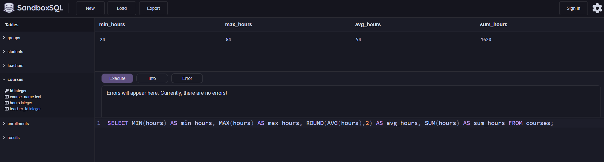

**GROUP BY и HAVING.** Группируем регистрации по статусу и оставляем статусы, встречающиеся более 100 раз.

```sql
SELECT status, COUNT(*) AS total FROM enrollments GROUP BY status HAVING COUNT(*) > 100 ORDER BY total DESC;
```

**Результат:**

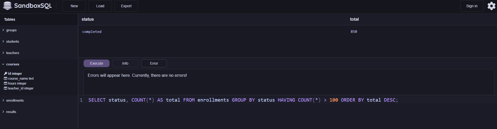

**Вывод:** в базе 850 аренд. `HAVING` отбирает группы после агрегирования; условие применяется к `COUNT(*)`.

## Шаг 5. Объединение связанных таблиц

**Студенты и группы.** Используем `INNER JOIN`, чтобы показать первых 10 студентов с их группами.

```sql
SELECT s.id, s.full_name, g.group_name
FROM students AS s
INNER JOIN groups AS g ON g.id = s.group_id
ORDER BY s.id
LIMIT 10;
```

**Результат:**

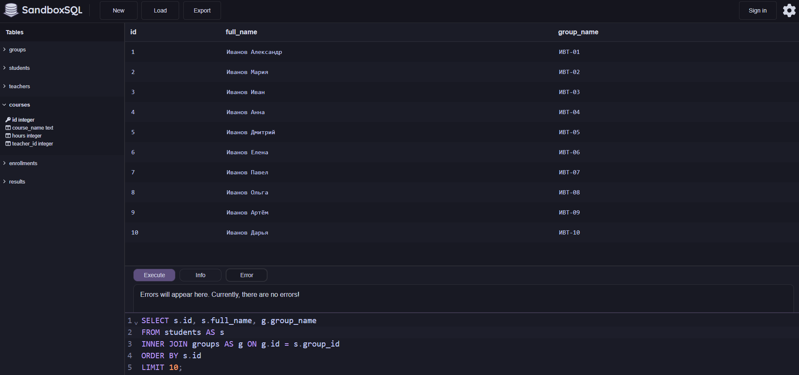

**Курсы и преподаватели.** Используем `INNER JOIN`, чтобы показать первых 10 курсов и закреплённых за ними преподавателей.
```sql
SELECT c.id, c.course_name, t.full_name AS teacher_name
FROM courses AS c
INNER JOIN teachers AS t ON t.id = c.teacher_id
ORDER BY c.id
LIMIT 10;
```

**Результат:**

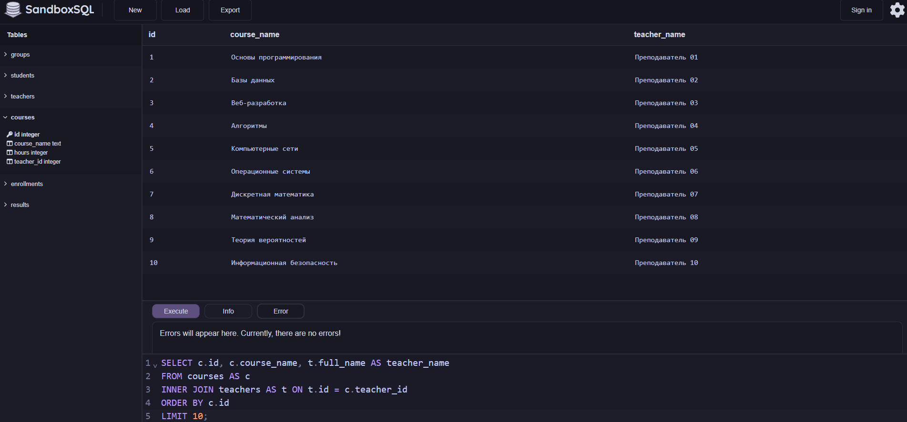

**Все учителя и курсы.** Используем `LEFT JOIN`, чтобы сохранить в результате все учителей, включая учителей без курсов.

```sql
SELECT t.id AS teacher_id, t.full_name AS teacher_name,
       c.id AS course_id, c.course_name
FROM teachers AS t
LEFT JOIN courses AS c ON c.teacher_id = t.id
ORDER BY t.id, c.id;
```

**Результат:**

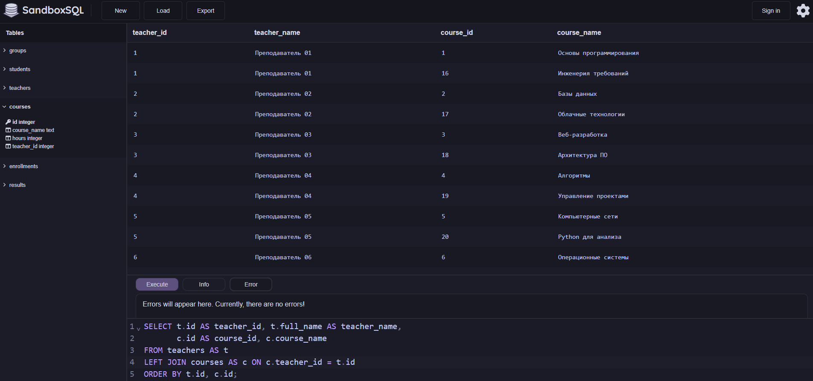

**Вывод:** `INNER JOIN` выводит совпавшие записи, а `LEFT JOIN` сохраняет строки из левой таблицы даже при отсутствии соответствий.

## Шаг 6. Проверка корректности данных

**Проверка корректности оценок.** Проверяем, нет ли счетов со значением больше 100, отрицательным или отсутствующим длительностью.

```sql
SELECT COUNT(*) AS invalid_scores
FROM results
WHERE score < 0 OR score > 100 OR score IS NULL;
```

**Результат:**

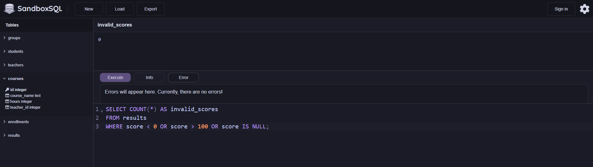

**Проверка связей между таблицами.** Проверяем, нет ли результатов, ссылающихся на несуществующую регистрацию.

```sql
SELECT COUNT(*) AS orphan_results
FROM results AS r
LEFT JOIN enrollments AS e ON e.id = r.enrollment_id
WHERE e.id IS NULL;
```

**Результат:**

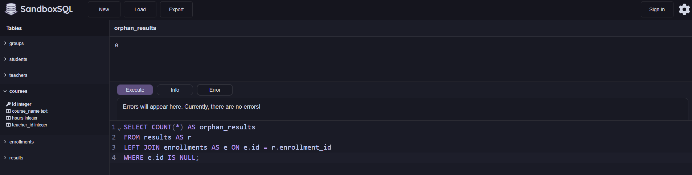

**Вывод:** оба запроса вернули 0. В рамках проведённых проверок нарушений не обнаружено. Это не означает, что проверены абсолютно все возможные ошибки в данных.

## Шаг 7. Индивидуальное аналитическое исследование (пример)

**Вариант:** 10 .

**Исследовательский вопрос:** Какие курсы имеют больше всего итоговых оценок и какова их средняя оценка? Объясните, почему количество записей на курс может отличаться от количества оценок.

**Используемые таблицы:** `courses`, `enrollments`, `results`.

**Метод исследования:** с помощью INNER JOIN, GROUP BY, COUNT и AVG определяем количество записей на курс, количество итоговых оценок и среднюю оценку по каждому курсу. Дополнительно через LEFT JOIN и GROUP BY со SUM(CASE …) разбиваем записи по статусам, чтобы объяснить расхождение между числом записей и числом оценок.

Для ответа на исследовательский вопрос выполняются два основных SQL-запроса:

**Аналитика по курсам.** Группируем записи и оценки по курсам, считаем число записей, число оценок и среднюю оценку.

```sql
SELECT c.id,
       c.course_name,
       COUNT(e.id) AS n_enrollments,
       COUNT(r.id) AS n_scores,
       ROUND(AVG(r.score), 2) AS avg_score
FROM courses AS c
LEFT JOIN enrollments AS e ON e.course_id = c.id
LEFT JOIN results AS r ON r.enrollment_id = e.id
GROUP BY c.id, c.course_name
ORDER BY n_scores DESC, avg_score DESC;
```

**Результат:**

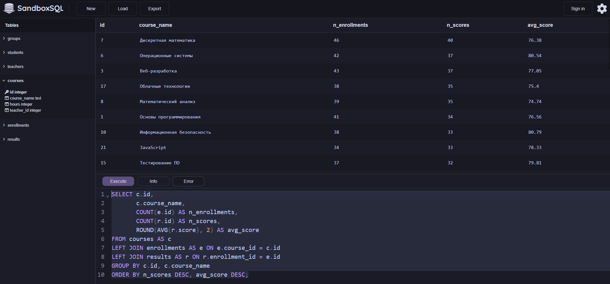

**Аналитика по статусам записей.** Сравниваем курсы по числу завершённых, активных и отменённых записей — это объясняет, почему n_scores меньше n_enrollments.

```sql
SELECT c.course_name,
       COUNT(e.id) AS n_enrollments,
       SUM(CASE WHEN e.status = 'completed' THEN 1 ELSE 0 END) AS n_completed,
       SUM(CASE WHEN e.status = 'active'    THEN 1 ELSE 0 END) AS n_active,
       SUM(CASE WHEN e.status = 'cancelled' THEN 1 ELSE 0 END) AS n_cancelled,
       COUNT(r.id) AS n_scores,
       ROUND(AVG(r.score), 2) AS avg_score
FROM courses AS c
LEFT JOIN enrollments AS e ON e.course_id = c.id
LEFT JOIN results AS r ON r.enrollment_id = e.id
GROUP BY c.id, c.course_name
ORDER BY n_scores DESC
LIMIT 10;
```

**Результат:**

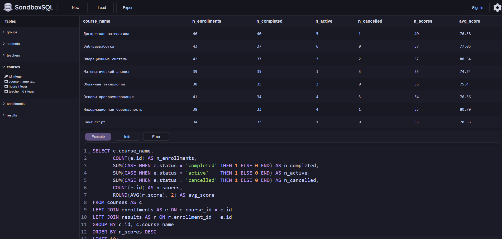

**Дополнительная проверка — курсы без оценок:**

**Курсы без оценок.** Используем LEFT JOIN для поиска курсов, у которых нет ни одной строки в results.

```sql
SELECT c.id, c.course_name, COUNT(e.id) AS n_enrollments
FROM courses AS c
LEFT JOIN enrollments AS e ON e.course_id = c.id
LEFT JOIN results AS r ON r.enrollment_id = e.id
WHERE r.id IS NULL
GROUP BY c.id, c.course_name
ORDER BY c.id;
```

**Результат:**

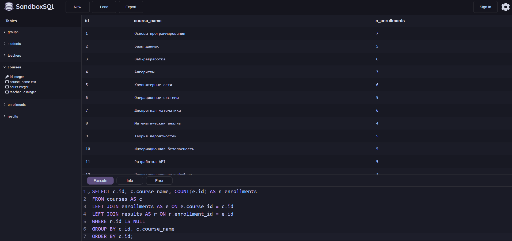

**Аналитические выводы:**

1.Наибольшее число итоговых оценок у курса «Дискретная математика» — 40 оценок при 46 записях, средняя оценка 76.38. В топ-5 по числу оценок также входят «Операционные системы», «Веб-разработка», «Облачные технологии», «математический анализ» — у каждого от 35 до 37 оценок и средние в диапазоне 74.74–80.54.

2. Число записей на курс всегда больше числа оценок: разница объясняется записями со статусом active (курс ещё не завершён) и cancelled (запись отменена) — у них строки в results нет. По базе в целом: 1000 записей и 850 оценок, то есть 150 записей без итогового результата.

3. Курсы-лидеры по числу оценок — это «массовые» курсы платформы; их средняя оценка опирается на большую выборку и потому наиболее устойчива. Курсы с единичными оценками (включая курсы без оценок вообще) в рейтинг по средней включать нельзя — статистически ненадёжно.

## Итог

В работе изучена структура SQLite-базы из шести связанных таблиц, выполнены запросы с `WHERE`, `ORDER BY`, `LIMIT`, агрегатными функциями, `GROUP BY`, `HAVING`, `INNER JOIN`, `LEFT JOIN`; проведены проверки целостности и отдельное аналитическое исследование.

**Ограничения:** средняя оценка отражает только завершённые записи и не учитывает состав студентов и причины отмены. Выводы относятся только к данному учебному набору данных.

## Структура файлов на GitHub

```text
lab04/
├── README.md
├── dataset.sqlite
├── report/
│   └── analysis.md
└── images/
    ├── step01_counts.png
    ├── step02_preview.png
    ├── step02_schema.png
    ├── step03_filter.png
    ├── step03_sort.png
    ├── step04_count.png
    ├── step04_aggregates.png
    ├── step04_having.png
    ├── step05_join_customers.png
    ├── step05_join_stations.png
    ├── step05_left_join.png
    ├── step06_invalid.png
    ├── step06_orphans.png
    ├── step07_categories.png
    ├── step07_station_revenue.png
    └── step07_unused.png
```